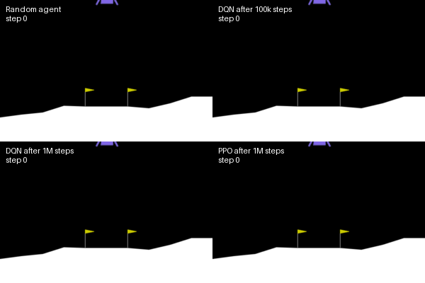
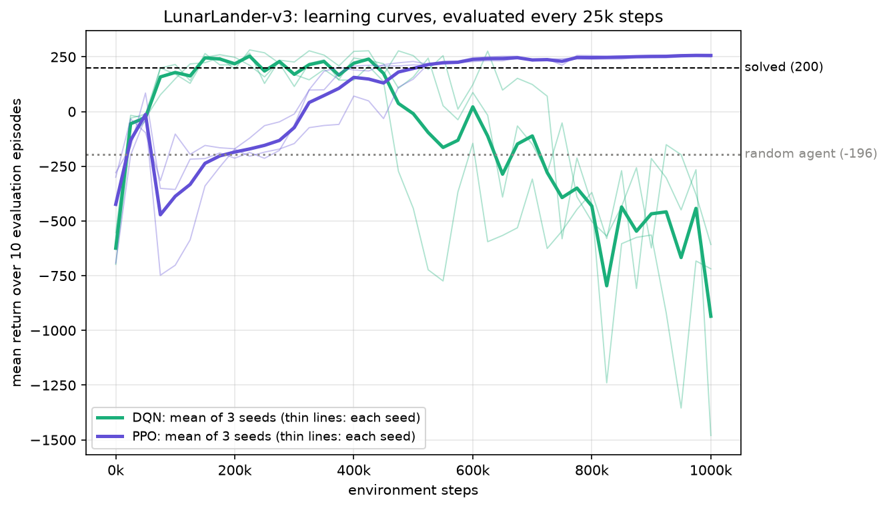
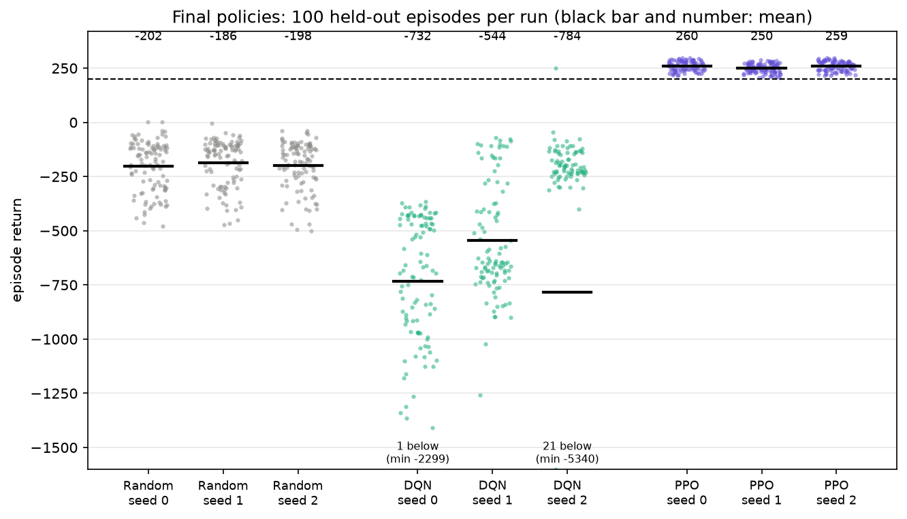

# DQN vs PPO on LunarLander


> Work in progress. v0.1 below is based on 3 seeds per algorithm. 10 seeds and confidence intervals come in the next milestone.

I am comparing two reinforcement learning algorithms, DQN and PPO, on Gymnasium's `LunarLander-v3`, where an agent has to land a module between two flags using its engines.

Most comparisons of this kind you find online rely on one or two training runs. In RL that is not enough: the same algorithm can solve the task with one random seed and fail with another. So I treat it as a measurement problem: same budget for both algorithms, several seeds, held-out evaluation episodes, and every number traceable to a CSV in `runs/`.



*Same held-out episode (seed 1,000,000, the first of the evaluation set, not picked by hand) played by four policies. DQN at 100k steps touches down but keeps firing its engines until the 1000-step limit. DQN at 1M steps flies off the side of the screen.*

## First results (v0.1, 3 seeds)

The short version: **DQN learns faster but does not keep what it learned. PPO is slower and stable.**



| Run | Final return, mean ± std (100 ep.) | Success rate | Best curve point | First step with curve ≥ 200 | Training time |
|---|---|---|---|---|---|
| Random seed 0 | -202.4 ± 117.4 | 0% | – | – | – |
| Random seed 1 | -186.4 ± 108.7 | 0% | – | – | – |
| Random seed 2 | -198.2 ± 110.0 | 0% | – | – | – |
| DQN seed 0 | -731.8 ± 321.5 | 0% | 278 at 325k | 100k | 111 min |
| DQN seed 1 | -544.1 ± 257.4 | 0% | 260 at 175k | 150k | 114 min |
| DQN seed 2 | -784.1 ± 1235.7 | 1% | 282 at 225k | 125k | 112 min |
| PPO seed 0 | 259.9 ± 21.2 | 100% | 260 at 1000k | 400k | 16 min |
| PPO seed 1 | 250.2 ± 20.9 | 100% | 251 at 975k | 525k | 17 min |
| PPO seed 2 | 258.8 ± 21.3 | 100% | 260 at 975k | 375k | 16 min |

Generated by `scripts/summarize.py`. A success is an episode with a return of at least 200, the threshold at which LunarLander counts as solved.

What I see so far:

- **DQN reaches the 200 threshold 3 to 4 times sooner** in environment steps (100k to 150k vs 375k to 525k for PPO).
- **Then all three DQN runs collapse.** Their curve first goes below 0 at 475k, 575k and 750k steps depending on the seed, and the final DQN policies are worse than a random agent. This is not one unlucky seed, it happens every time.
- **PPO holds on to what it learned.** Seed 2 dips to 190 and 186 just after first crossing 200, the other two seeds never go back below 200. Every final PPO policy succeeds in all 100 held-out episodes.
- **In wall-clock time, PPO wins by far**: about 16 min against 112 min on my laptop CPU. DQN does one gradient update per environment step (`gradient_steps: -1`), PPO trains in large batches.



### Why DQN collapses: what I know and what I don't

The Zoo hyperparameters I use for DQN were tuned for 100k steps. I run it for 1M so both algorithms get the same budget, and it works fine up to about where it was tuned for. My guess is that once the agent lands well, its 50k-transition replay buffer fills up with landings only, and it forgets how to recover from bad states. This is a known failure mode, but **I have not tested it yet**, so for now it is a hypothesis, not a result.

### Limits of these numbers

- 3 seeds per algorithm is too few for confidence intervals. That is the next milestone.
- Learning-curve points use 10 episodes each, so they are noisy, and "best curve point" is the maximum of noisy values: it is optimistic by construction.
- Hyperparameters come from the Zoo and were not tuned by me, for either algorithm.

## How it is measured

- **Same budget**: 1M environment steps for both. PPO stops at 1,015,808 because one PPO update consumes 16 × 1024 steps.
- **Learning curve**: every 25k environment steps, 10 deterministic episodes, always the same 10 start seeds (10000 to 10009). The trigger counts environment steps rather than callback calls, otherwise PPO with 16 parallel envs would be evaluated 16 times less often than DQN.
- **Final evaluation**: 100 deterministic episodes on seeds 1,000,000 to 1,000,099, never used during training.
- **Hardware for v0.1**: AMD Ryzen 3 7320U laptop, no GPU, 3 runs in parallel with 1 torch thread each. One thread measured twice as fast as four for these small networks.
- Each `runs/<algo>/seed_<k>/meta.json` stores the config, library versions, git commit and timings of the run.

## Roadmap

| Milestone | Content | Status |
|---|---|---|
| J0 | Project setup, tests, CI | done |
| J1 | Training and evaluation pipeline, first 3 seeds, before/after video | done (v0.1) |
| J2 | 10 seeds per algorithm, statistics with confidence intervals | planned |
| J3 | Robustness map under perturbations | planned |
| J4 | ONNX export and int8 quantization | planned |
| J5 | Closed-loop inference on Raspberry Pi 5 | planned |

## Reproduce

Python 3.10 to 3.12 (PyTorch has no wheels for newer versions yet).

```bash
python -m venv .venv
.venv/bin/pip install -r requirements.txt    # Windows: .venv\Scripts\pip
.venv/bin/pip install -e . --no-deps
pytest -v

# one run
python -m lunarlander_rl.train --config configs/ppo.yaml --seed 0
python -m lunarlander_rl.evaluate --run-dir runs/ppo/seed_0

# several runs, 3 in parallel (Windows or Linux), then figures, table and video
python -m lunarlander_rl.launcher dqn:0-2 ppo:0-2
python scripts/plot_results.py
python scripts/summarize.py
python scripts/record_video.py
```

## Dependencies and licenses

- [Gymnasium](https://github.com/Farama-Foundation/Gymnasium) (MIT): LunarLander environment
- [Box2D](https://github.com/pybox2d/pybox2d) (zlib): physics engine used by LunarLander
- [Stable-Baselines3](https://github.com/DLR-RM/stable-baselines3) (MIT): DQN and PPO implementations
- [RL Baselines3 Zoo](https://github.com/DLR-RM/rl-baselines3-zoo) (MIT): hyperparameters, commit `eec15dc`
- [PyTorch](https://github.com/pytorch/pytorch) (BSD-style), [matplotlib](https://matplotlib.org) (PSF-style), [imageio](https://github.com/imageio/imageio) (BSD-2)

## License

MIT
